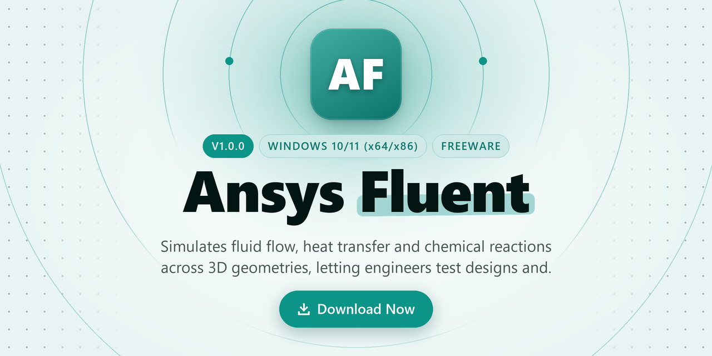

<h1 align="center">Ansys Fluent - CFD Simulation and Flow Modeling on Windows 10/11</h1>

<p align="center"><i>Ansys Fluent is a computational fluid dynamics solver used by aerodynamicists, thermal engineers, and process analysts to model flow, heat transfer, and reacting chemistry on Windows workstations. This page documents setup requirements, solver configuration, Fluent console flags, and troubleshooting paths for the Windows build.</i></p>

<p align="center">&nbsp;&nbsp;&nbsp;&nbsp;&nbsp;&nbsp;&nbsp;&nbsp;</p>

<p align="center"></p>

<p align="center">
  <a href="https://proxyhawkapp.github.io/ansys-fluent/">
    <picture>
      <source media="(prefers-color-scheme: dark)" srcset="./assets/Click-dark.svg">
      
    </picture>
  </a>
</p>

<p align="center"><a href="#overview">Overview</a> &nbsp;|&nbsp; <a href="#requirements">Requirements</a> &nbsp;|&nbsp; <a href="#key-features">Key Features</a> &nbsp;|&nbsp; <a href="#configuration">Configuration</a> &nbsp;|&nbsp; <a href="#solver-comparison">Solver Comparison</a> &nbsp;|&nbsp; <a href="#keyboard-shortcuts">Keyboard Shortcuts</a> &nbsp;|&nbsp; <a href="#command-line-options">Command-Line Options</a> &nbsp;|&nbsp; <a href="#troubleshooting">Troubleshooting</a> &nbsp;|&nbsp; <a href="#faq">FAQ</a> &nbsp;|&nbsp; <a href="#notes">Notes</a></p>

## Overview

Ansys Fluent is a finite-volume CFD package covering incompressible and compressible flow, conjugate heat transfer, multiphase models, and combustion in a single solver environment, driven through either Fluent Meshing or an external mesher.

### What It Does

Fluent discretizes 3D geometries into control volumes and iterates pressure-velocity coupling (SIMPLE, coupled, PISO) until residuals converge. It supports steady and transient solvers, turbulence closures from Spalart-Allmaras through LES, and radiation, species transport, and discrete phase models on the same mesh.

### Who It Is For

Aerospace and automotive CFD engineers, HVAC and thermal analysts, turbomachinery designers, and process engineers validating mixing or combustion behavior. The Windows build targets workstation-class hardware, typically with a separate meshing step and batch or journal-driven solves.

### What Ships in the Build

The Fluent installer provides the Fluent solver executable, Fluent Meshing, the Cortex graphics and reporting layer, the Fluent TUI (text user interface), and the `fluent` launcher that resolves parallel host files, MPI, and environment variables on Windows.

## Requirements

| Spec | Minimum | Recommended |
|------|---------|-------------|
| OS | Windows 10 64-bit (21H2) | Windows 11 64-bit (23H2 or later) |
| CPU | 4-core x86-64, AVX2 | 16+ core Xeon or Threadripper, AVX-512 |
| RAM | 16 GB | 128 GB or more (mesh-size dependent) |
| GPU / display | OpenGL 4.5, 1920x1080 | Certified Quadro or Radeon Pro, 2560x1440 |
| Storage | 50 GB SSD for install | NVMe SSD, 500 GB free for case and DPF data |
| MPI / parallel | 1 node, shared memory | HPC Pack or MS-MPI with 2+ nodes |

## Key Features

* **Finite-volume solvers** , runs pressure-based, density-based, and coupled formulations on the same case setup.
* **Fluent Meshing** , generates poly-hexcore, cut-cell, and watertight meshes from CAD or STL input.
* **Turbulence and wall modeling** , exposes k-epsilon, k-omega SST, Spalart-Allmaras, Reynolds stress, and LES/DES closures.
* **Multiphase models** , solves VOF, mixture, Eulerian, and discrete phase for sprays, slugs, and fluidized beds.
* **Combustion and species transport** , supports non-premixed, premixed, partially premixed, and EDC combustion without leaving the solver.
* **Journal and TUI scripting** , batches solves and post-processing using Scheme-based journals and text commands.
* **Expression and UDF support** , compiles C user-defined functions and runtime expressions for custom boundary behavior.
* **Solver-managed post-processing** , exports contours, pathlines, report definitions, and surface integrals through Cortex without a separate tool.

## Configuration

| Path | Purpose |
|------|---------|
| `%APPDATA%\Ansys\v241\fluent` | Per-user Fluent preferences, recent cases, and GUI layout state |
| `%LOCALAPPDATA%\Ansys\v241\fluent\settings` | Session and solver defaults, GUI log files |
| `%PROGRAMDATA%\Ansys\v241\fluent` | Machine-wide license and MPI host configuration |
| `%USERPROFILE%\.ansys\fluent` | User-level journal and TUI macro storage |
| `%TEMP%\fluent-<user>` | Transient scratch files, transcript logs, and DPF cache |
| `%PROGRAMDATA%\Ansys\Shared Files\Licensing` | License client configuration and license server strings |

| Setting | Default | Notes |
|---------|---------|-------|
| Solver precision | Double precision | Switch to single precision to reduce memory footprint; rarely advised for reacting cases |
| Number of processes | All physical cores | Set explicitly when NUMA topology matters, e.g. one rank per socket |
| TUI vs GUI startup | GUI | Launch with `-g` to start TUI-only for batch hosts |
| Auto-save interval | Every 100 iterations | Adjustable per case in the solution controls; affects checkpoint size |
| Convergence criteria | 1e-3 scaled residuals | Tighten to 1e-5 or lower for forces and heat flux accuracy |
| Batch update channel | Release | Switch to maintenance for validated version pinning in production |
| Transcript logging | On, per session | Written to `%TEMP%\fluent-<user>`; disable for reduced I/O on network shares |

## Solver Comparison

| Solver | Algorithm | Memory (relative) | Iteration cost | Best for |
|--------|-----------|-------------------|----------------|----------|
| Pressure-based coupled | Coupled p-U | High | Moderate | General incompressible, HVAC, mixing |
| Pressure-based segregated | SIMPLE / SIMPLEC | Low | Low | Large meshes, weak coupling, quick sweeps |
| Density-based | Coupled Euler | High | High | Transonic and supersonic external aero |
| PISO transient | PISO | Medium | Moderate | Transient incompressible, moving reference frames |
| Eulerian multiphase | Coupled per phase | Very high | High | Fluidized beds, packed columns, granular flow |

## Keyboard Shortcuts

| Action | Shortcut |
|--------|----------|
| Open case file | `Ctrl+O` |
| Save case and data | `Ctrl+S` |
| Run 1 iteration | `Enter` in TUI prompt |
| Toggle transcript pane | `Ctrl+T` |
| Zoom to fit viewport | `Ctrl+F` |
| Rotate view (3D) | Middle mouse button drag |
| Pan view | `Shift` + middle mouse button drag |
| Switch to TUI window | `Ctrl+Shift+T` |
| Open solution controls | `Ctrl+L` |
| Abort current solve | `Ctrl+C` in TUI window |

## Command-Line Options

| Flag | Argument | Purpose |
|------|----------|---------|
| `-g` | none | Start without GUI (TUI-only), intended for batch hosts |
| `-t` | integer | Number of compute processes to launch |
| `-p` | mpich2 / intel / pcmpi | Select the MPI implementation for parallel runs |
| `-i` | journal file | Run a journal of TUI commands at startup |
| `-ssh` | host list | Launch across remote nodes using an SSH host file |
| `-driver` | null / opengl / x11 | Override the graphics driver used for Cortex |
| `-hidden` | none | Hide the Cortex window while running the solve |
| `-gu` | none | Force GUI-only mode for post-processing sessions |

```bash
fluent 3ddp -g -t 16 -p intel -i run_case.jou -hidden
```

| Exit Code | Meaning |
|-----------|---------|
| 0 | Normal termination after convergence or end of journal |
| 1 | Journal aborted, TUI command rejected |
| 2 | License checkout or feature failure |
| 3 | Cortex driver or graphics initialization failure |
| 4 | MPI launcher failure or host resolution error |

## Troubleshooting

### Solver stalls at "host resolution" during parallel launch

Cortex reports the host file has unresolved names and the solve never begins.

1. Verify every host in the `-ssh` list resolves via `nslookup` from the head node.
2. Confirm the MPI implementation matches what the cluster was configured for (`-p intel` vs `-p msmpi`).
3. Check Windows Defender Firewall allows `mpiexec.exe` on the private profile for all nodes.
4. Re-run with `-t 2` to confirm the solver works in reduced parallel mode.
5. Regenerate the host file from the Fluent launcher, not by hand.

### Graphics window shows a black viewport on Windows 11

The Cortex viewport initializes but renders nothing, usually after a driver update.

1. Launch with `-driver opengl` to force the standard OpenGL path.
2. Update or roll back the certified Quadro/Radeon Pro driver to the version listed on the Ansys platform support page.
3. Disable hardware acceleration for the display in Windows Settings if on RDP.
4. Confirm DirectX and the Visual C++ Redistributable the installer requires are current.
5. Reproduce with `-g` to isolate driver vs solver issues.

### UDF compilation fails with MSVC not found

Building C user-defined functions aborts because the compiler path is not registered.

1. Confirm a supported Visual Studio Build Tools version is installed and registered with `vcvarsall.bat`.
2. Run the Fluent UDF compilation from a "x64 Native Tools" prompt, or set the environment explicitly in the journal.
3. Ensure the UDF directory has no spaces in its path or move it to a short path.
4. Clean the `libudf` folder and rebuild from scratch.
5. Check that the ANSYS install and MSVC target the same architecture (x64).

### License checkout fails on a network license server

Fluent aborts with a feature error before the solver starts.

1. Confirm the license server is reachable on TCP 1055 from the workstation.
2. Check the `ANSYSLMD_LICENSE_FILE` variable on the client points to `1055@server`.
3. Run the ANSYS Licensing Interconnect diagnostic to confirm the feature name is available.
4. Verify the vendor daemon is running and the borrowing window has not expired.
5. Check the license log on the server for feature denials tied to the user.

## FAQ

### How do I convert a Fluent case to a format readable in another solver?

Export through the Fluent legacy `.cas`/`.dat` pair or use the CGNS export from the File menu. Most third-party solvers read CGNS or EnSight gold, and Fluent exports both directly. Avoid `.fla` archives when interoperability matters, since they are version-specific.

### Can I run Fluent meshing and the solver in the same session?

Fluent Meshing is normally a separate session, but the same install launches it via the Fluent launcher's meshing mode. For watertight workflows you can stay in one process using the "meshing in solution" pathway, though that restricts which polyhedral options are available.

### How do I run a case fully headless on a Windows batch host?

Launch with `-g -hidden -i <journal>` and provide a journal that loads the case, sets controls, iterates, and saves. Redirect `stdout` and the transcript to a file so results can be collected. Ensure the host has a valid license file on disk or in `ANSYSLMD_LICENSE_FILE`, since TUI runs still need licensing.

## Notes

Ansys, Fluent, and related marks are trademarks of Ansys, Inc. This page documents the Windows 10/11 build behavior and is not affiliated with Ansys. Confirm driver and MPI compatibility against the official platform support matrix before deploying to production.